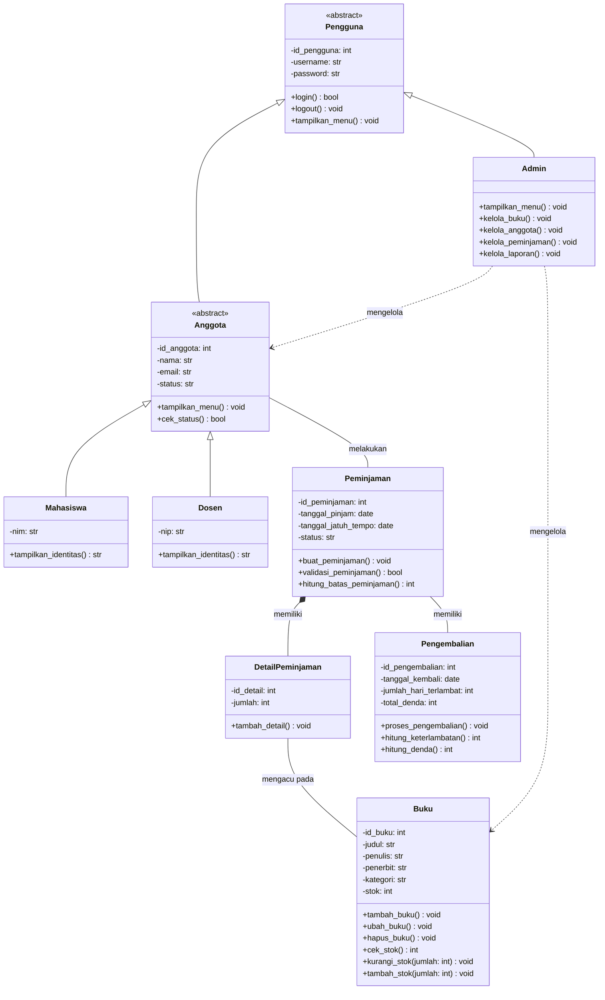

# Blueprint: Sistem Informasi Perpustakaan Kampus

Dokumen ini berisi spesifikasi arsitektur perangkat lunak berdasarkan UML Class Diagram untuk **Sistem Informasi Perpustakaan Kampus**, lengkap dengan aturan bisnis dan relasi antar entitas.

---

## 1. Visualisasi Class Diagram (Mermaid)

---

## 2. Spesifikasi Kelas & Atribut

### A. Hierarki Pengguna
1. **`Pengguna` (`<<abstract>>`)**
   - **Atribut:**
     - `id_pengguna`: `int` (Private)
     - `username`: `str` (Private)
     - `password`: `str` (Private)
   - **Metode:**
     - `login() -> bool`: Memvalidasi kredensial pengguna.
     - `logout() -> void`: Mengakhiri sesi pengguna.
     - `tampilkan_menu() -> void`: Metode abstrak untuk menampilkan opsi menu sesuai peran.

2. **`Admin`** *(Turunan dari `Pengguna`)*
   - **Metode:**
     - `tampilkan_menu() -> void`: Implementasi menu khusus administrator.
     - `kelola_buku() -> void`: Manajemen CRUD data buku.
     - `kelola_anggota() -> void`: Manajemen CRUD dan verifikasi status anggota.
     - `kelola_peminjaman() -> void`: Memantau dan memproses transaksi peminjaman/pengembalian.
     - `kelola_laporan() -> void`: Mencetak atau melihat rekapitulasi data perpustakaan.

3. **`Anggota` (`<<abstract>>`)** *(Turunan dari `Pengguna`)*
   - **Atribut:**
     - `id_anggota`: `int` (Private)
     - `nama`: `str` (Private)
     - `email`: `str` (Private)
     - `status`: `str` (Private, misal: `'aktif'`, `'nonaktif'`)
   - **Metode:**
     - `tampilkan_menu() -> void`: Implementasi menu khusus anggota.
     - `cek_status() -> bool`: Mengecek apakah anggota berstatus aktif dan layak meminjam.

4. **`Mahasiswa`** *(Turunan dari `Anggota`)*
   - **Atribut:**
     - `nim`: `str` (Private)
   - **Metode:**
     - `tampilkan_identitas() -> str`: Mengembalikan informasi nama dan NIM mahasiswa.

5. **`Dosen`** *(Turunan dari `Anggota`)*
   - **Atribut:**
     - `nip`: `str` (Private)
   - **Metode:**
     - `tampilkan_identitas() -> str`: Mengembalikan informasi nama dan NIP dosen.

---

### B. Entitas Inventaris & Transaksi

6. **`Buku`**
   - **Atribut:**
     - `id_buku`: `int` (Private)
     - `judul`: `str` (Private)
     - `penulis`: `str` (Private)
     - `penerbit`: `str` (Private)
     - `kategori`: `str` (Private)
     - `stok`: `int` (Private)
   - **Metode:**
     - `tambah_buku() -> void`
     - `ubah_buku() -> void`
     - `hapus_buku() -> void`
     - `cek_stok() -> int`
     - `kurangi_stok(jumlah: int) -> void`
     - `tambah_stok(jumlah: int) -> void`

7. **`Peminjaman`**
   - **Atribut:**
     - `id_peminjaman`: `int` (Private)
     - `tanggal_pinjam`: `date` (Private)
     - `tanggal_jatuh_tempo`: `date` (Private)
     - `status`: `str` (Private, misal: `'dipinjam'`, `'selesai'`)
   - **Metode:**
     - `buat_peminjaman() -> void`
     - `validasi_peminjaman() -> bool`: Memastikan anggota aktif, stok tersedia, dan batas maksimal peminjaman tidak terlampaui.
     - `hitung_batas_peminjaman() -> int`: Menghitung sisa kuota buku yang boleh dipinjam anggota.

8. **`DetailPeminjaman`** *(Komposisi dari `Peminjaman`)*
   - **Atribut:**
     - `id_detail`: `int` (Private)
     - `jumlah`: `int` (Private)
   - **Metode:**
     - `tambah_detail() -> void`: Menambahkan item buku ke dalam transaksi peminjaman.

9. **`Pengembalian`**
   - **Atribut:**
     - `id_pengembalian`: `int` (Private)
     - `tanggal_kembali`: `date` (Private)
     - `jumlah_hari_terlambat`: `int` (Private)
     - `total_denda`: `int` (Private)
   - **Metode:**
     - `proses_pengembalian() -> void`: Mengubah status peminjaman menjadi selesai dan mengembalikan stok buku.
     - `hitung_keterlambatan() -> int`: Menghitung selisih hari antara `tanggal_kembali` dan `tanggal_jatuh_tempo`.
     - `hitung_denda() -> int`: Menghitung total denda berdasarkan hari keterlambatan dan jumlah buku.

---

## 3. Relasi Antar Kelas

- **Inheritance (Pewarisan):**
  - `Admin` dan `Anggota` mewarisi kelas abstrak `Pengguna`.
  - `Mahasiswa` dan `Dosen` mewarisi kelas abstrak `Anggota`.
- **Association (Asosiasi):**
  - `Anggota` *melakukan* `Peminjaman`.
  - `DetailPeminjaman` *mengacu pada* `Buku`.
  - `Peminjaman` *memiliki* `Pengembalian`.
- **Composition (Komposisi):**
  - `Peminjaman` *memiliki* `DetailPeminjaman` (siklus hidup `DetailPeminjaman` bergantung penuh pada `Peminjaman`).
- **Dependency (Ketergantungan):**
  - `Admin` *mengelola* `Buku` dan `Anggota`.

---

## 4. Aturan Bisnis (Business Rules)

1. **Batas Peminjaman Aktif:** Maksimal **2 buku** aktif per anggota pada waktu yang bersamaan.
2. **Durasi Peminjaman:** Maksimal **7 hari** terhitung sejak `tanggal_pinjam`.
3. **Perhitungan Denda:** Denda keterlambatan sebesar **Rp200 per buku per hari** keterlambatan.
4. **Kesetaraan Aturan:** Seluruh aturan peminjaman dan denda berlaku **sama** untuk `Mahasiswa` maupun `Dosen`.